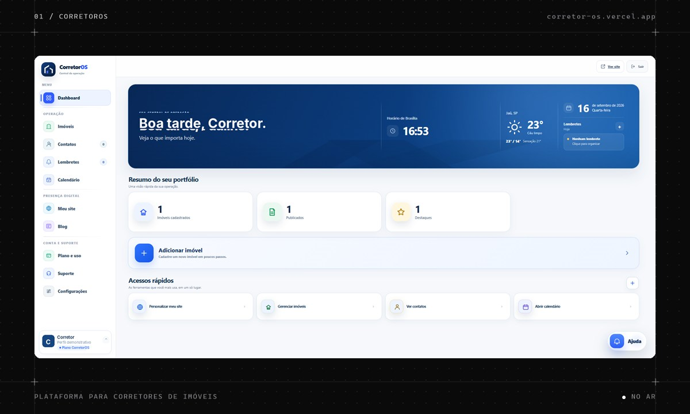
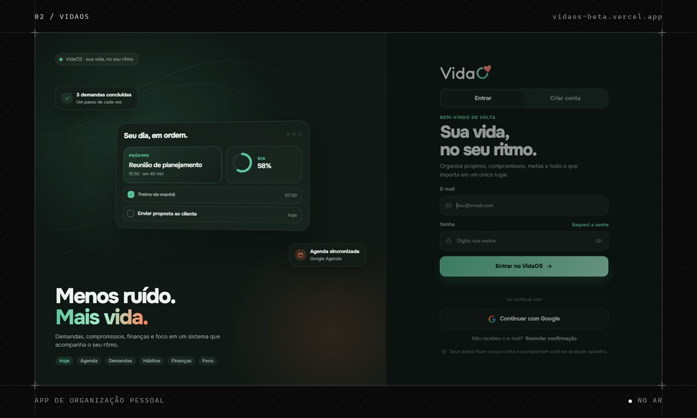

  

  
  

## Sobre

Sou o Eduardo, marketeiro de Jaú-SP, viciado em tecnologia e curioso por natureza. Gosto de transformar ideias em produtos digitais que funcionam de verdade.

Trabalho com estratégia de marketing, identidade visual e landing pages. Nas horas livres: treino, video game, pesca e fotografia.

> *"Tudo posso naquele que me fortalece."* 
> Filipenses 4:13

## Projetos

<table>
  <tr>
    <td width="50%" valign="top">
      
      <h3>CorretorOS</h3>
      
Plataforma para corretores de imóveis. Site com a marca do corretor, página para cada imóvel, contatos, agenda e lembretes em um só painel.

      
<a href="https://corretor-os.vercel.app">Acessar o site</a>

    </td>
    <td width="50%" valign="top">
      
      <h3>VidaOS</h3>
      
App de organização pessoal. Demandas, compromissos, hábitos, finanças e foco em um só lugar, sincronizado com o Google Agenda.

      
<a href="https://vidaos-beta.vercel.app">Acessar o site</a>

    </td>
  </tr>
</table>

## Tecnologias

   HTML &nbsp;&nbsp;
   CSS &nbsp;&nbsp;
   JavaScript &nbsp;&nbsp;
   Supabase &nbsp;&nbsp;
   Vercel &nbsp;&nbsp;
   GitHub

